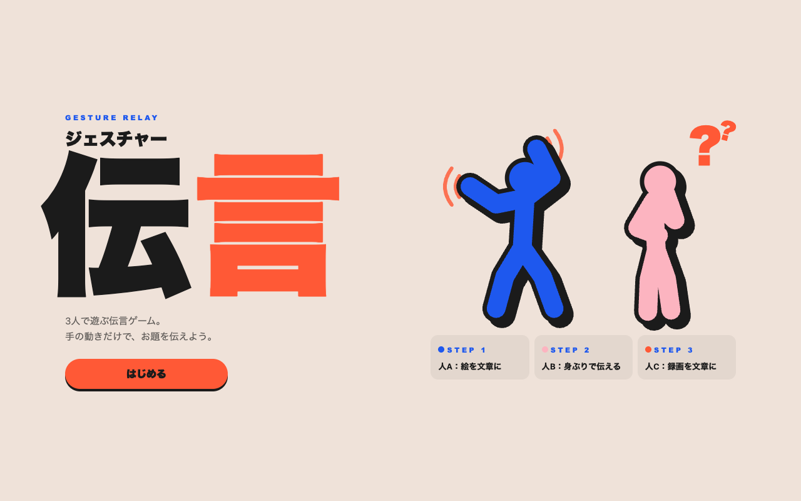
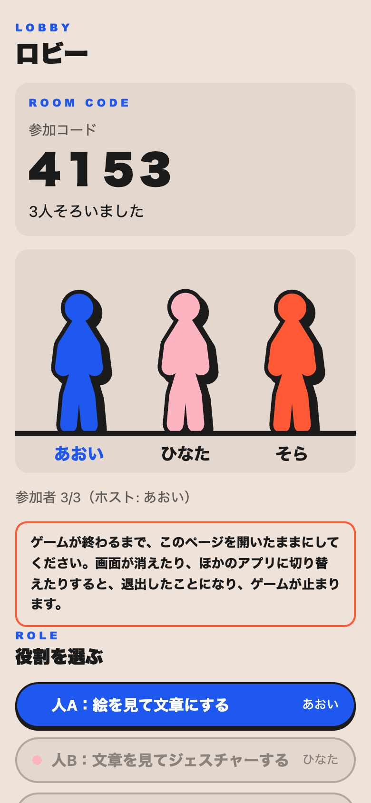
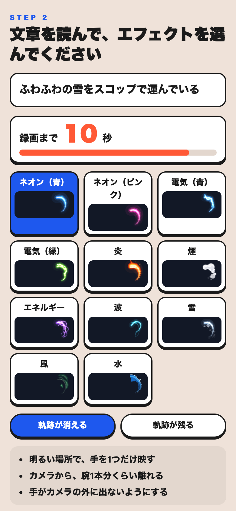
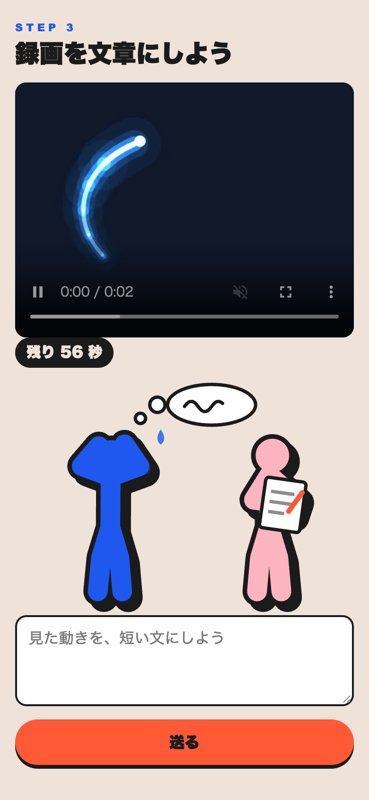
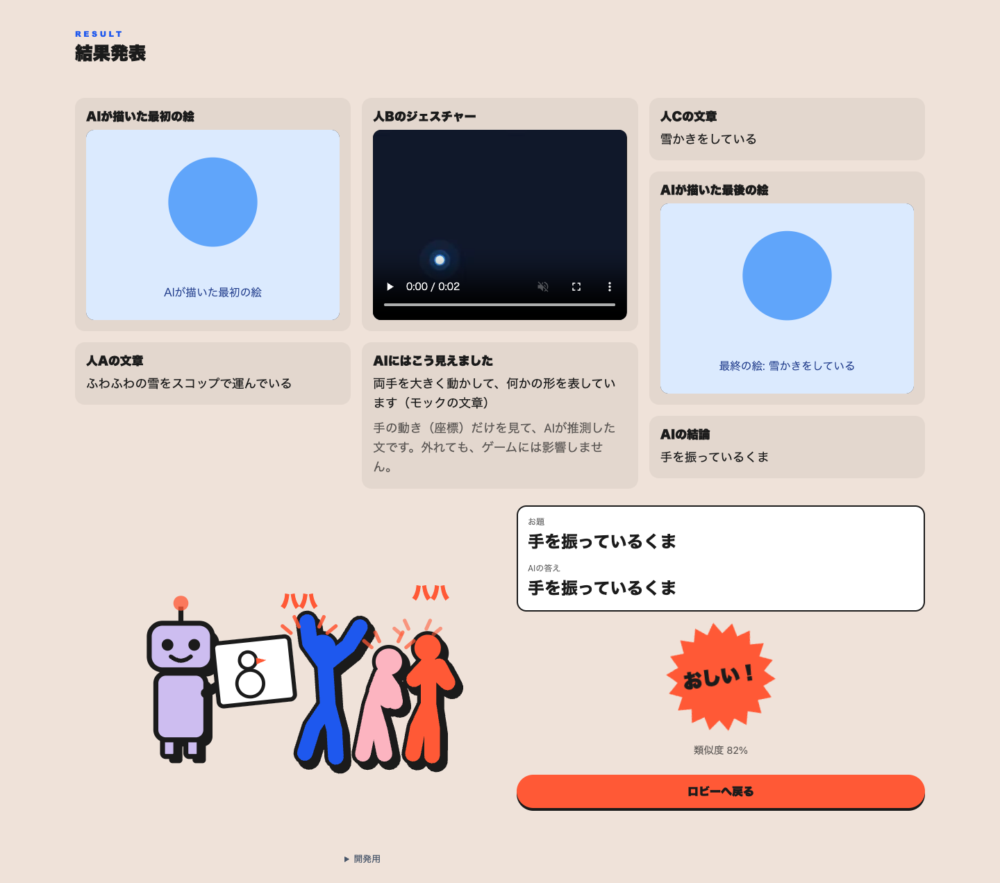
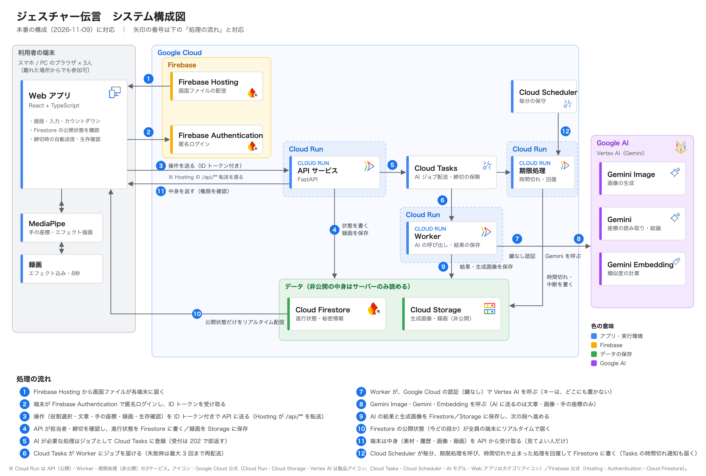

# ジェスチャー伝言（GESTURE RELAY）

**手の動きだけで、お題を伝える3人の伝言ゲーム。** 最後は AI が絵を描き、お題を当てにきます。

**遊ぶ: https://gesture-relay-game.web.app** （3人がそれぞれのスマホ・パソコンで開きます。人B の端末にはカメラが必要です）

<p>
  
</p>

## なぜ作ったか

ライブや映画で感動しても「すごかった」「めっちゃ良かった」しか出てこず、どこがどう良かったのかを人に伝えられない。そんな「心が動いたことを、自分の言葉で伝えられない」もどかしさが出発点です。「見たものを言葉にする」「言葉を体で伝える」を遊びの中で繰り返し、どこで伝わらなくなったかを、みんなで笑いながら振り返れるゲームにしました。

## どんなゲームか

3人がそれぞれ別の端末（スマホ・パソコン）から、4桁の参加コードで同じ部屋に入ります。離れた場所からでも遊べます。お題が「絵 → 文章 → ジェスチャー → 文章 → 絵」と伝わっていく間に、どんどん形が変わっていくのを楽しむゲームです。

| 段 | だれが | すること |
|---|---|---|
| 0 | AI | お題（例: 「走っているいぬ」）から絵を描く |
| 1 | 人A | AI の絵を見て、文章にする |
| 2 | 人B | 人A の文章を読み、エフェクトを選んで、カメラの前で8秒間ジェスチャーをする（手の動きに光る線が付いて録画される） |
| 3 | 人C | 人B の録画を見て、文章にする |
| 4 | AI | 人C の文章から、最後の絵を描く |
| 5 | AI | 最後の絵から、お題を当てる |

結果発表では、伝言の流れを1段ずつめくり、最後にお題と AI の答えを並べて「近い！」「おしい！」「遠い…」のスタンプを押します。裏では、AI が人B の手の動き（座標）だけを見て「AIにはこう見えました」という読み取りも出します。1回の所要時間は、部屋を作ってから結果発表まで約2〜3分です。

### 工夫したところ

- **手の動きに光る線のエフェクト**: 手の検出（MediaPipe）で両手の位置を追い、ネオン・電気・炎・煙・水など11種類の線を描きます。軌跡を残すか消すかも選べます。ボタンには小さな動く見本が付いていて、初めてでも見た目が分かります。
- **録画までの流れ**: 残り時間を大きな数字と減っていく帯で示し、最後の「3・2・1」はカメラ映像の上にも重ねます。録画が始まるまでは試し描きができ、「明るい場所で手を1つだけ映す」などの案内も出します。
- **ルール**: 空中に文字を書くのは禁止。矢印などの記号は使えます。
- **プライバシー**: AI に送るのは手の座標だけで、映像は送りません。録画と絵は非公開です。参加の前に、カメラと座標と録画について同意を取ります。
- **見た目と動き**: 生成りの背景に、青・ピンク・オレンジを人A・人B・人C の色として割り当て、太い文字と、黒い縁取りのぷっくりした人の絵でそろえました。タイトルが飛び込む、画面の切り替えでオレンジの帯が横切る、録画開始で画面が光る、スタンプで画面が揺れる、などの動きを付け、AI を待つ間はロボットが絵を描くアニメーションを流します。
- **人の絵のアニメーション**: ロビーでは、参加した順に、歩いて・上から落ちて・下から登って合流し、先にいた人が手を貸します。結果発表では、AI の答えを見て3人が笑います。関節の角度でつなぐので、腕や脚の長さが変わらない、なめらかな動きです。
- **スマホでもパソコンでも**: スマホは縦1列、パソコンは左右2列に並べ替えます。パソコンの結果発表は3列にして、絵と録画を大きく見せます。
- **止まりにくい作り**: 待っている間に画面が消えないようにし、生存確認が一度固まっても次を送ります。途中でページを再読み込みしても、同じ回の続きから再開でき、書きかけの文章も戻ります。

<p>
  
  
  
</p>
<p>
  
</p>

（画像はモックで撮ったもので、AI の絵は仮の絵です。本物の AI の絵は、上の URL で遊ぶと見られます。）

## しくみ

<p>
  
</p>

| 部分 | 使っているもの | 担当 |
|---|---|---|
| 画面 | React 19・TypeScript・Vite、手の検出 MediaPipe Tasks Vision（端末の中で動く）、録画 MediaRecorder | フロント |
| 配信 | Firebase Hosting（`/api/**` を Cloud Run の API へ転送） | フロント |
| ログイン | Firebase Authentication（匿名ログイン。API の呼び出しに ID トークンを付ける） | フロント・A |
| API・進行・締切 | Python（FastAPI）、Cloud Run（API・期限処理）、Cloud Scheduler（毎分の保守）、Firestore、Cloud Storage | A |
| AI の仕事 | Cloud Tasks、Cloud Run の Worker、Vertex AI（絵を描く Gemini 3.1 Flash Image、手の動きの読み取りとお題当て Gemini 3.5 Flash、近さの計算 gemini-embedding-001） | B |

- 画面は Firestore の「公開してよい進み具合」だけをリアルタイムで購読し、絵・文章・録画などの中身は API から、見てよい人だけが受け取ります。
- AI の処理は数十秒かかるので、API は Cloud Tasks に仕事を積んで先に返事をし、Worker が AI を呼びます。AI は鍵を使わず、Google Cloud の認証で呼びます。

決まりごとの正本は [仕様書](docs/specification.md)、[共有する型](docs/shared-types.md)、[変更履歴](docs/changelog.md) です。構成図の編集用の元ファイルは [docs/submission/architecture.svg](docs/submission/architecture.svg) です。

## 試し方

### 本番で遊ぶ

https://gesture-relay-game.web.app を3つの端末（または3つのブラウザ）で開き、1人が部屋を作って、残りの2人が参加コードで入ります。3人がそろったら、それぞれ人A・人B・人C を選び、部屋を作った人が「ゲームを始める」を押します。手順は [3人の通しテストの手順書](docs/e2e-test-guide.md) にもあります。

### ブラウザだけで遊ぶ（モック・サーバー不要）

```bash
cd frontend
npm install
npm run dev
```

`http://localhost:5173/?dev=3` を開くと、3人分の画面が横に並び、1台で最後まで遊べます（AI の絵は仮の絵）。カメラを使わずに試すときは `?dev=3&fake_camera=1` を付けます。詳しくは [frontend/README.md](frontend/README.md)。

### 本物のサーバーをローカルで動かす

エミュレーターと API の起動は、下の「開発者向け」と [チーム結合手順](docs/team-integration-guide.md) を参照してください。

## 開発者向け（バックエンド）

### ローカルセットアップ

Python 3.11以上が必要です。依存導入時以外はネットワーク不要です。

```bash
python3.11 -m venv .venv
.venv/bin/pip install -c requirements.lock -e '.[dev]'
.venv/bin/pytest -q
.venv/bin/ruff check api backend_a common tests
.venv/bin/ruff format --check api backend_a common tests
RUNTIME_MODE=local ENABLE_CLOUD=false .venv/bin/uvicorn api.main:app --host 127.0.0.1 --port 8000
```

local modeはFirebase・Google SDKクライアントも認証情報も初期化しません。
認証はローカル限定の `Authorization: Bearer local:alice`（英数字等のUID）です。
共通起動口 `python -m backend_a.entrypoint` も、local modeでは既定で `127.0.0.1` に待ち受けます。
別端末からの検証が必要な場合は、信頼できる検証用ネットワークで `LOCAL_BIND_HOST=<この端末のLAN IP>` を明示してください。この待受に到達できる端末は任意のローカルUIDを指定できます。
本番Firebaseトークンはlocal modeでは使えません。データはプロセス終了で失われます。
`.env.example` は自動読込しません。必要な値をシェルでexportしてください。

`http://127.0.0.1:8000/docs` にOpenAPIがあります。公開APIに `/internal` はありません。
ローカルでAIは自動実行しません。

```bash
.venv/bin/pytest -q tests/test_game_api.py::test_full_three_player_game_history_and_cleanup
```

第2フェーズではBの実 `handle_job → run_job` を使う検証も追加しています。
推論だけをBのMockAIClientにし、IO・結果保存・進行・再配送は接続部を通します。

```bash
.venv/bin/pytest -q tests/test_worker_integration.py
.venv/bin/pytest -q tests/test_s1_contract.py tests/test_worker_contracts.py
```

### Emulator Suite

Node 24系とJava 21以上を推奨します。CLIログインは不要です。
必ず `demo-gesture-relay` を指定し、実プロジェクトには接続しません。

```bash
cd tools/emulator
pnpm install --frozen-lockfile --ignore-scripts
cd ../..
env -u GOOGLE_APPLICATION_CREDENTIALS -u FIREBASE_TOKEN \
  CI=true XDG_CONFIG_HOME="$PWD/.tools/config" \
  FIREBASE_EMULATORS_PATH="$PWD/.tools/emulators" \
  tools/emulator/node_modules/.bin/firebase emulators:exec \
  --project demo-gesture-relay --only auth,firestore,storage \
  'bash tools/emulator/run_checks.sh'
```

Rulesの拒否テスト後、同じPython APIテストをFirestore Emulatorに対して実行します。
Auth Emulatorの匿名トークンもAdmin SDKで検証します。
Cloud Tasksはモック。Storage SDK保存・取得・削除と、別API/Workerクライアントのゲーム進行もStorage Emulatorで検証します。
外向きsocketを禁止し、明示したloopbackのみ許可します。
テストはdemoプロジェクトのエミュレーターデータを毎回削除します。

### Workerとの接続

最新正本ではBの `run_job → write_job_result` 後にAの `advance_step` を呼びます。
別Runサービスでも、同じPythonパッケージを利用できます。

```python
from backend_a.runtime import build_runtime
from backend_a.progress import configure_progress, advance_step
from common.storage import configure_storage

runtime = build_runtime()  # 明示したlocal/emulator/cloud設定
configure_progress(runtime.game)
configure_storage(runtime.game.storage)
# Bが結果・jobs・stepをTransactionで確定した後:
advance_step(room_id, round_id)
```

payloadには参照IDのみを含みます。保存形式・未合意点は
[integration](docs/backend-a-integration.md) を参照してください。
デプロイ・Hosting案は [infra](infra/README.md) にあります。

Bの元の `worker.main` はログ用SinkとB専用設定の入口を維持しています。
このブランチの永続接続用factoryは `api.worker_app.create_worker_app(runtime, ai)` です。
両引数は明示注入し、実AIクライアントや本番認証情報を自動取得しません。
`/tasks/run` と `/internal/jobs` は内部認証を要求します。
統合した起動口は `python -m backend_a.entrypoint`。`SERVICE_ROLE=api|worker|deadlines` で選択します。
`SERVICE_ROLE=worker` は永続IO/Sinkを持つ `api.worker:app` を構築します。
Bの従来の `worker.main:app` はログ専用で、永続Workerのデプロイ先に使いません。
結果保存後の進行失敗はprogress_outbox、推論中断はexecution_outboxから回復します。
回復処理は保守ループとheartbeatが実行するため、無稼働時の回復時間は別途インフラ検証が必要です。
